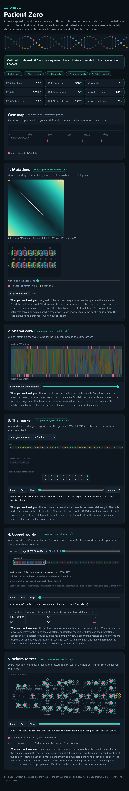

# Assignment 4. Patient Zero

Student ID: 250986
Name: Tilekkali Nurtore
Group: SE - 2540

This file is the report. How to start: `START_HERE.md`. The task: `docs/Assignment4.pdf`.

## Program output

The 9 lines my program prints on my data (`java -cp out Main`):

    Mutations: 97
    Shared core: 900
    Marker hits: 6
    First hit: 9831
    Border length: 3
    Shared words: 269
    Tests needed: 38
    Cheapest testing: 177
    Longest chain: 29

My outbreak report (a screenshot of `output/outbreak.html`):

## Questions

**Mission 1. What does the cell d[i][j] of your table mean, and how is it computed from other cells?**

d[i][j] is the fewest changes needed to turn the first i letters of A into the first j letters of B. To fill a cell I look at three neighbours and take the smallest. From the diagonal cell d[i-1][j-1] I add 0 if the two letters are the same and 1 if they differ. From the cell above, d[i-1][j], I add 1 for deleting a letter. From the cell on the left, d[i][j-1], I add 1 for inserting a letter. The first row is 0, 1, 2... and so is the first column, because turning a word into an empty word (or the other way) just means deleting or inserting everything. The answer is in the bottom right corner.

**Mission 2. How is the longest common subsequence different from the longest common substring? My Shared core is bigger than the number of letters that are the same at the same place: why?**

A substring has to be one unbroken piece in both strains. A subsequence can skip letters, as long as the order stays the same. The table is the same shape as before. If the two letters are equal I take d[i-1][j-1] + 1. If not, I take the bigger of the cell above and the cell on the left. My Shared core is 900, which is more than the letters that match at the same index. When B has an extra letter or is missing one, everything after it moves by one place. Those letters still match in order, but a position-by-position check would miss them.

**Mission 3. What does the prefix function tell you, and why does the pointer in the text never go back in KMP? What is the Border length of my marker and what does it mean?**

For each position i, pi[i] tells me how long the longest beginning of the marker is that is also an ending of p[0..i] (not counting the whole thing). KMP keeps a number k, which is how many marker letters match right now. When the next letter does not match, I don’t step back in the text. I only shrink k to pi[k-1]. The letters I just read already match the start of the marker for that many places, so there is no reason to read them again. The text index only goes forward, so the work is O(n + m). After a full match I set k = pi[m-1] so that overlapping matches are not lost. My Border length is 3. This means the first 3 letters of my marker are the same as its last 3, so two hits can overlap by 3 letters.

**Mission 4. Why must you compare the letters after the hashes are equal? What happens to the cost of Rabin-Karp if many windows have the same hash?**

Two different words can end up with the same hash, which is called a collision, because there are far more possible words than hash values. Equal hashes only mean the words might be equal. Without the letter check I would count words that are not really in B, and my answer would change if I changed MOD. Each check costs O(k). If a lot of windows share a hash, I have to do many checks, and the running time goes from about O(n + m) toward O(n·k), which is close to the naive search.

**Mission 5. What are the two states of a person in your DP, and how do you get the answer for a person from its children? Why does a greedy "test the person with most links first" not always give the cheapest answer?**

For every person v I keep two numbers for v and everything below him. in[v] is the cheapest cost if v is tested, and out[v] is the cheapest cost if v is not tested. If v is tested, his links to the children are already covered, so in[v] is cost[v] plus the sum of min(in[c], out[c]) over his children. If v is not tested, every child has to be tested, so out[v] is the sum of in[c]. I fill these from the leaves up to the root, and the answer is min(in[0], out[0]). Then I walk back down from the root to find who is actually tested. For the longest chain I keep the two longest ways down from each person, and the best chain through him is their sum. Greedy can fail because the person with the most links may be expensive, and his neighbours might cover the same links more cheaply. It also ignores what happens lower in the tree, so a choice that looks good at one person can force more tests below him.

## AI use

ChatGPT was used to review the code, help understand problems, and edit the text to make explanations clearer and easier to understand.

## Timing (Mission 7)

Milliseconds, average of 3 runs, from `java -cp out Bench`.

| test | size | time |
|---|---|---|
| naive search | 20 000 | 59.5 ms |
| naive search | 40 000 | 114.2 ms |
| naive search | 80 000 | 226.7 ms |
| KMP | 20 000 | 2.6 ms |
| KMP | 40 000 | 1.3 ms |
| KMP | 80 000 | 0.7 ms |
| edit distance | 500 | 7.3 ms |
| edit distance | 1000 | 8.7 ms |
| edit distance | 2000 | 28.5 ms |
| edit distance | 4000 | 108.7 ms |

When the text doubles, the search time also roughly doubles (59.5, 114.2, 226.7 ms). That is linear growth in the text length, but the constant is big because the pattern has 2000 letters, so the cost is O(n·m). KMP stays at a few milliseconds, O(n + m). Its numbers don’t grow because they are too small to measure well, and the first run is slower because Java is still warming up (JIT). Edit distance grows about four times each time the length doubles (28.5 ms to 108.7 ms). That fits O(n·m), which is O(n²) when both strains have the same length.

## Complexity

n is the length of the text (or of a strain), m the length of the pattern, k the length of the window, v the number of people.

| algorithm | time | space | assumptions |
|---|---|---|---|
| Edit distance | O(n·m) | O(n·m) | two nested loops over the table of (n+1)·(m+1) cells; n and m are the lengths of the two strains |
| LCS | O(n·m) | O(n·m) | the same table and loops as edit distance, only the rule for a cell is different |
| Prefix function and KMP | O(n + m) | O(m) | the prefix function is O(m); the text pointer never goes back, and k goes up by at most 1 per letter, so it goes down at most n times in total; the table pi has m numbers (without the list of hits) |
| Rabin-Karp (shared words) | O(n + m) on average, O(n·k) in the worst case | O(m) | rolling hash is O(1) per move; set lookup is O(1) on average; the worst case is when many hashes collide and every candidate must be compared in O(k) |
| Tree DP | O(v) | O(v) | every person and link is visited a constant number of times; arrays of size v for the two states, the parent and the order |

## Before you submit

- The four files in `data` and the screenshot `output/outbreak.png` are in the repository.
- `java tools/Check.java` shows all examples right.
- This README is filled in, the program output included.
- The work is pushed to main (at least one commit per mission) and the repository is public.
- The link is attached in Moodle.